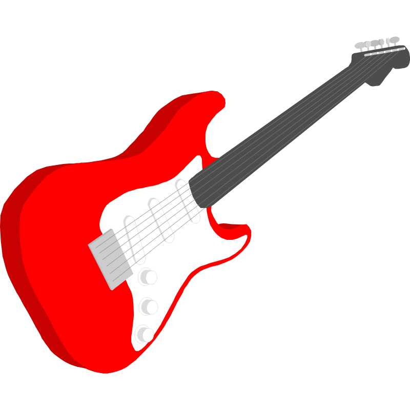

  <strong>Hej!</strong>

Efter att ha utforskat både musikbranschen och sjukvården (som legitimerad logoped) har jag äntligen hittat ett område där jag verkligen känner mig hemma - programmering. Kombinationen av oändliga utvecklingsmöjligheter, problemlösning, analytiskt tänkande och teamwork är precis vad jag söker i mitt framtida yrkesliv.

  

    

      Från musiken har jag med mig det kreativa skapandet och förmågan att driva projekt i hamn. Som logoped har jag utvecklat ett systematiskt arbetssätt och en analytisk förmåga, med fokus på evidensbaserade metoder, två världar som visat sig vara överraskande relevanta även inom IT-branschen.
    

    
  

När det kommer till de mer tekniska sidor gillar jag att botanisera i digitala inspelningsmiljöer och att starta utvecklingsprojekt i syfte att testa olika idéer och lära mig nya tekniker. Jag trivs i miljöer där man arbetar tillsammans för att skapa och förbättra programvaror. Att se något växa fram i samarbete med andra ger mig både energi och ny kunskap, vilket jag värderar högt på arbetsplatsen.

Kollegor har beskrivit mig som någon som naturligt tar plats och lyfter relevanta frågor som för gruppen framåt, alltid med känsla för dynamik och stämningen i rummet.

Efter att ha pratat med Patrik Fallqvist tror jag att MobilityGuard skulle passa mig väldigt bra. Det verkar finnas en stark teamkänsla och stora möjligheter att utvecklas inom företaget. Dessutom känns det stimulerande att få arbeta med både ny och etablerad teknik, som WizePass och OneGate.

Jag ser fram emot att höra från er och möjligheten att ses personligen.

  ---

<strong style="color: #dcdcdc;">Vänliga hälsningar</strong>  
<strong style="color: #dcdcdc;">Freddie</strong>

